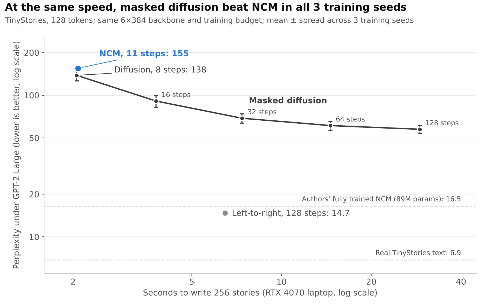

# Next-Concept Modeling on a Laptop: a small, fair reproduction

**Does Stanford's Next-Concept Modeling (NCM) keep its edge over masked diffusion when you train it yourself on one consumer GPU?**
This repo reproduces the authors' released TinyStories model, then runs a controlled three-way race between NCM, masked diffusion and a left-to-right (GPT-style) model, all trained from scratch on an RTX 4070 Laptop GPU (8 GB).

[](https://colab.research.google.com/github/<your-username>/<your-repo>/blob/main/ncm_tinystories_experiment.ipynb)
&nbsp;📄 [Article](https://medium.com/@nikhilrajm78/stanford-says-this-ai-writes-up-to-31-faster-i-tested-it-on-my-laptop-e5e3b7f725a9) &nbsp;·&nbsp; 🎬 [60-second video](<your-video-link>) &nbsp;·&nbsp; 📑 [Paper (arXiv:2610.14162)](https://arxiv.org/abs/2610.14162)



## TL;DR

| Finding | Result |
|---|---|
| The authors' released model reproduces | Perplexity **16.5** on my laptop vs **15.4** in the paper (entropy 3.97 vs 3.98) |
| NCM is fast | 256 stories in **2.1 s**, ~3× faster than the left-to-right model |
| …but at laptop scale it is not better than masked diffusion | At the same 2.1 s, diffusion (8 steps) scored **138** vs NCM's **155**, and won in **3 of 3** training seeds |
| Left-to-right still writes the best text | **14.7**, close to the authors' fully trained NCM |

This is a **small-scale finding, not a refutation**. See [Is the comparison fair?](#is-the-comparison-fair) for the caveats, including one that favours the baselines.

## What is NCM? (the 30-second version)

| | Left-to-right (GPT-style) | Masked diffusion | Next-Concept Modeling |
|---|---|---|---|
| How it writes | One token at a time | Fills blanks everywhere, over many rounds | Coarse sketch first, then finer levels |
| Steps for a 128-token text | 128 | 8–128+ (your choice) | 12 (one per level) |
| Analogy | A typist | A crossword solver | A painter: sketch, then detail |

NCM first trains a **multiscale residual VQ-VAE** that compresses a text into a ladder of 12 levels of discrete codes (1 → 8 → 16 → … → 128). A transformer then predicts each level **in parallel**, conditioned on all coarser levels. Here is a story from my 12M-parameter model, decoded after levels 1, 5, 8 and 12:

```text
level  1 (1 code)    Sara and Ben are friends. They like to play outside. They was to. and. a and..
level  5 (32 codes)  Sara and Sam are twins. They like to the hidden. It in in room.. One day, they they to to
level  8 (64 codes)  Anna and Anna are friends friends They They to pencil big. Fluffy in the the grass. One day,,
level 12 (128 codes) Anna and Anna are twins friends. They liked to the big big port in the grass. One day, they went
```

A single code already carries the plot; finer levels add names, places and detail.

## Results

TinyStories, 128 tokens. All models use the same 6-layer × 384-wide backbone (the authors' transformer block) and the same total training budget. Mean ± std over **3 training seeds × 3 sampling seeds × 256 samples**; perplexity under GPT-2 Large via the authors' own `generation_perplexity` function.

| Model | Steps | Gen. PPL ↓ | Entropy | Seconds / 256 samples |
|---|---|---|---|---|
| Real TinyStories text | – | 6.89 | 3.98 | – |
| **NCM** (11 levels predicted + 1 sampled) | 11 | 154.93 ± 3.59 | 3.97 | 2.1 |
| Masked diffusion, T=8 | 8 | 138.21 ± 10.48 | 4.10 | 2.1 |
| Masked diffusion, T=16 | 16 | 90.98 ± 7.97 | 4.08 | 3.8 |
| Masked diffusion, T=32 | 32 | 68.78 ± 4.77 | 4.07 | 7.4 |
| Masked diffusion, T=64 | 64 | 61.07 ± 3.93 | 4.06 | 14.6 |
| Masked diffusion, T=128 | 128 | 57.49 ± 3.35 | 4.07 | 29.1 |
| Autoregressive (KV cache) | 128 | 14.71 ± 0.52 | 4.02 | 6.5 |
| *Authors' released NCM (89M params, full training)* | *12* | *16.52* | *3.97* | – |

**Head-to-head at equal speed, per training seed** (mean of 3 × 256 samples):

| Training seed | NCM, 11 steps | Diffusion, 8 steps | Diffusion ahead by |
|---|---|---|---|
| 0 | 157.3 | 151.9 | 5.4 |
| 1 | 153.6 | 132.3 | 21.3 |
| 2 | 153.9 | 130.4 | 23.5 |

Raw per-run numbers: [`results/results_3seeds.json`](results/results_3seeds.json).

## Is the comparison fair?

| Concern | What I did | Which way it pushes |
|---|---|---|
| **Generator updates** | Total training stories matched at 1.28M (the paper's accounting, compressor included), so NCM's generator got **4,000** updates vs **10,000** for the baselines | **Favours the baselines**: the biggest caveat |
| GPU time | NCM's generator used ~3× the GPU time of each baseline (87 vs 28 min per seed) | Favours NCM |
| Model size | 12.4M vs 16.9M params; the gap is the baselines' word-embedding tables, and the transformer cores are identical | Minor |
| Implementation | NCM uses the **authors' own classes** (`VQVAE`, `NextConceptTransformer`). A training-path vs `generate()` consistency check agrees 100%, and the released model reproduces. Baselines use standard MDLM / GPT recipes | Low risk for NCM; baselines untuned |
| Hyperparameters | One schedule for all, no tuning; NCM code-corruption follows the paper (linearly decreasing, mean 0.5) | Unknown |
| Timing | Same GPU, batch 64, fp32; diffusion samples only the positions it reveals | Roughly fair |
| Statistics | Diffusion won 3/3 seeds, but n = 3 (a 3/3 sweep happens by chance 1 time in 8) | Consistent, not conclusive |

**Next experiment:** give NCM's generator the same 10,000 updates, then scale models and data up to find where (if anywhere) NCM overtakes diffusion.

## Run it yourself

### Option A: Google Colab
Click the badge above → **Runtime → Change runtime type → T4 GPU** → **Run all**.

### Option B: Local (NVIDIA GPU, ≥ 8 GB)
```bash
git clone https://github.com/<your-username>/<your-repo>.git
cd <your-repo>
pip install torch --index-url https://download.pytorch.org/whl/cu124   # any CUDA build of PyTorch
pip install notebook
jupyter notebook ncm_tinystories_experiment.ipynb                       # then Run All
```
The notebook installs everything else itself (omegaconf, hydra-core, transformers, datasets, …), clones the authors' code at a pinned commit, and downloads TinyStories, the released checkpoint and GPT-2 Large (~8 GB disk in total). Requirements: Python ≥ 3.10 and git.

### Settings
In the **Settings** cell:

| Preset | What it trains | Time on an RTX 4070 Laptop |
|---|---|---|
| `quick` (default) | 6×384 models, 1 training seed | ~3 h |
| `quick` with `train_seeds=[0, 1, 2]` | same, 3 seeds (the results above) | ~7–8 h |
| `article` | 8×512 models, longer training, 3 seeds | > 15 h (use a bigger GPU) |

Finished models are saved and **reused on rerun**, so an interrupted run picks up where it stopped. On GPUs with less memory the notebook automatically splits each batch into chunks (gradient accumulation: same updates, less memory).

## What the notebook does

1. **Part A — Reproduce:** downloads the authors' TinyStories checkpoint and runs their `evaluate.py` (5 seeds × 256 samples), plus level-by-level trajectories.
2. **Part B — Train:** tokenizes TinyStories with the authors' 8,192-token BPE (a cached encoder, checked token-for-token against theirs), then trains:
   - the NCM tokenizer (multiscale residual VQ-VAE, 12 levels, EMA codebooks, fine-level dropout),
   - the NCM generator (block-diagonal attention, codebook-tied heads, code corruption),
   - a masked-diffusion baseline (MDLM-style, linear schedule, 1/t-weighted loss),
   - an autoregressive baseline (same backbone, KV-cache sampling).
3. **Part C — Evaluate:** Gen. PPL under GPT-2 Large + unigram entropy, steps and wall-clock time, summary table, charts and samples, all zipped into `ncm_results.zip`.

## Repo structure

```text
.
├── README.md
├── ncm_tinystories_experiment.ipynb   # the whole experiment
├── results/
│   ├── results_3seeds.json            # every (model, training seed, sampling seed) run
│   └── summary_table.md
└── assets/
    └── fig_results.png                # headline chart
```

## Citation

If you use this, please cite the original paper:

```bibtex
@misc{kumbong2026nextconcept,
      title={Next-Concept Modeling: Fast, Parallel Coarse-to-Fine Text Generation},
      author={Hermann Kumbong and Ishan S. Khare and Iddah Mlauzi and Andrew Woen and Charles Ding and E. Kelly Buchanan and Simran Arora and Azalia Mirhoseini and Christopher Ré},
      year={2026},
      eprint={2610.14162},
      archivePrefix={arXiv},
      primaryClass={cs.CL},
      url={https://arxiv.org/abs/2610.14162},
}
```

## Acknowledgements and license

Model code, released checkpoints and evaluation scripts are from [HazyResearch/ncm](https://github.com/HazyResearch/ncm) (MIT license), used at commit `c702742`. This repo adds the training loops, baselines, evaluation harness and analysis. TinyStories is by Eldan & Li (2023).
This repo is released under the MIT license. Not affiliated with the paper's authors.
